<div align="center">

# SILENCE OF THE LIMBS

**A 2–4 Player First-Person Multiplayer Horror-Arena Game built in Godot 4.7**

[](https://github.com/vvadithya/FindersKeepers-CSES/releases/tag/v2.0.0)
[](https://godotengine.org/)
[](#5-networking--replication-networkingnetworkmanagergd)
[](#-download-v200)

<p>
  <a href="#-interactive-feature-showcase"><strong>Feature Showcase</strong></a> •
  <a href="#-explore-every-feature-click-to-expand"><strong>Deep-Dive Galleries</strong></a> •
  <a href="#-core-systems--implementation"><strong>Core Systems</strong></a> •
  <a href="#-controls"><strong>Controls</strong></a> •
  <a href="#-download-v200"><strong>Download v2.0.0</strong></a> •
  <a href="#-running-from-source"><strong>Build from Source</strong></a> •
  <a href="ABOUT.md"><strong>About</strong></a>
</p>

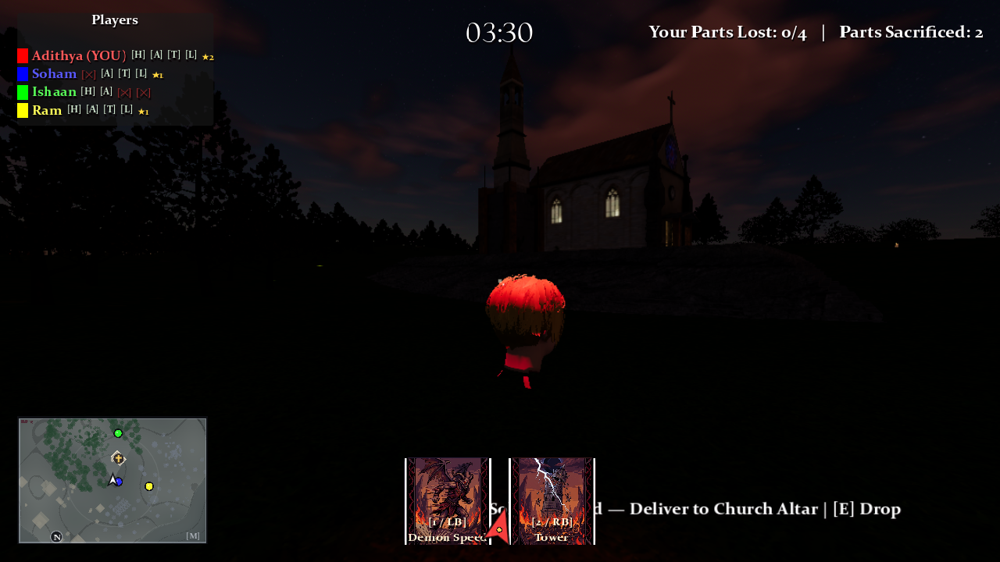

<sub><em>Hauling Soham's severed head back to the moonlit Church Altar — Crimson Altar Compass locked on, GTA V-style minimap tracking rivals in real time.</em></sub>

</div>

---

## The Pitch

Four players awaken inside an abandoned gothic church at the heart of a dense, storm-lit island. Everyone's body has been sliced into **four physical limbs** — **Head, Hands, Torso, and Legs** — and scattered across the woods, ruins, and coastline.

Hunt down your rivals' body parts, haul them back to the central **SpellCenter Altar**, and burn them for permanent passive buffs. Lose all 4 of your limbs and you're **sacrificed** into spectator mode. Survive until the 5-minute ritual clock expires and whoever sacrificed the most limbs wins. Along the way, scavenge glowing **Tarot Cards** to blind rivals, invert their controls, supercharge your speed, or blast them off ledges — and vote on mid-match **Blood Shrine** deals.

> See [ABOUT.md](ABOUT.md) for the lore overview, playable cast, and release history.

---

## 📸 Interactive Feature Showcase

Every screenshot below is captured live in **Godot 4.7 Forward+ (Vulkan, 1280×720)** from the `v2.0.0` build.

<table>
  <tr>
    <td width="50%" align="center">
      <a href="docs/screenshots/05_church_altar_hud.png">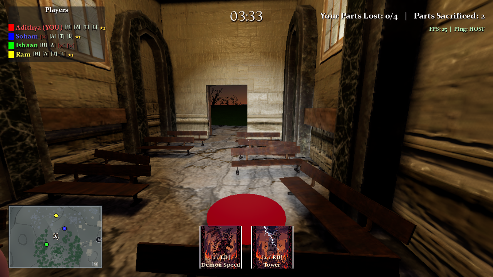</a>
      <br/><sub><strong>Church Altar Hub &amp; Live HUD</strong> — SpellCenter sacrifice altar, custom player names, Tarot slots, GTA V minimap &amp; <code>F3</code> FPS/Ping overlay.</sub>
    </td>
    <td width="50%" align="center">
      <a href="docs/screenshots/06_gta_minimap_expanded.png">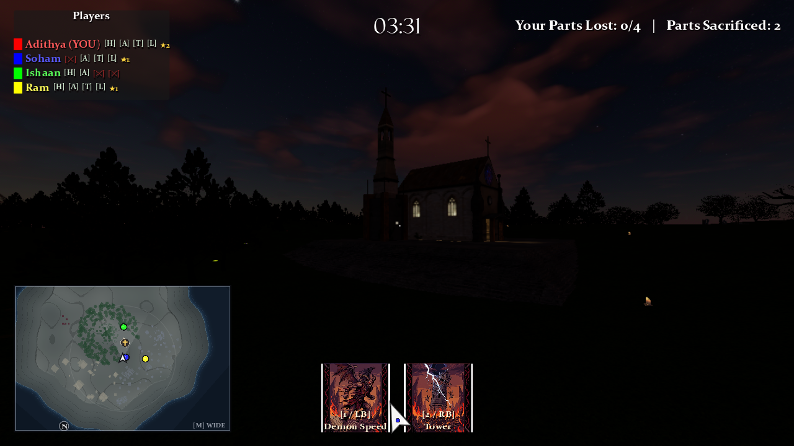</a>
      <br/><sub><strong>GTA V-Style Minimap (<code>[M] WIDE</code>) &amp; White Arrow Compass</strong> — Rotating island radar with circular player dots + crisp multiplayer body-part pointer.</sub>
    </td>
  </tr>
  <tr>
    <td width="50%" align="center">
      <a href="docs/screenshots/03_lobby_customization.png">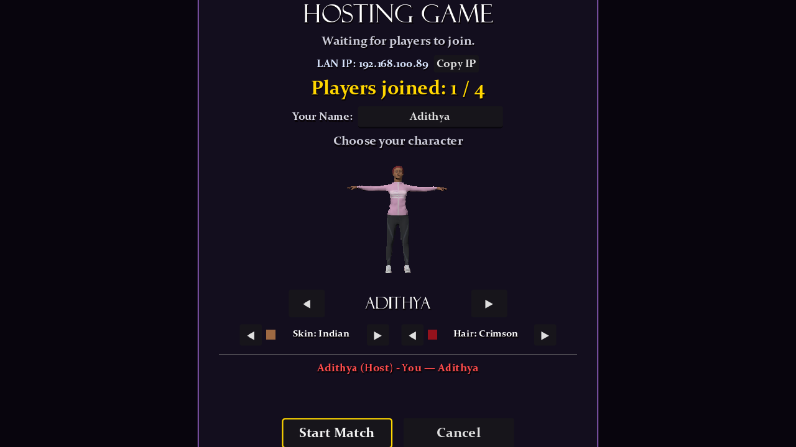</a>
      <br/><sub><strong>3D Lobby &amp; Live Character Customization</strong> — Keyboard-only custom name, Skin/Hair pickers, drag-to-spin 3D preview &amp; one-click LAN IP copy.</sub>
    </td>
    <td width="50%" align="center">
      <a href="docs/screenshots/04_skin_hair_presets.png">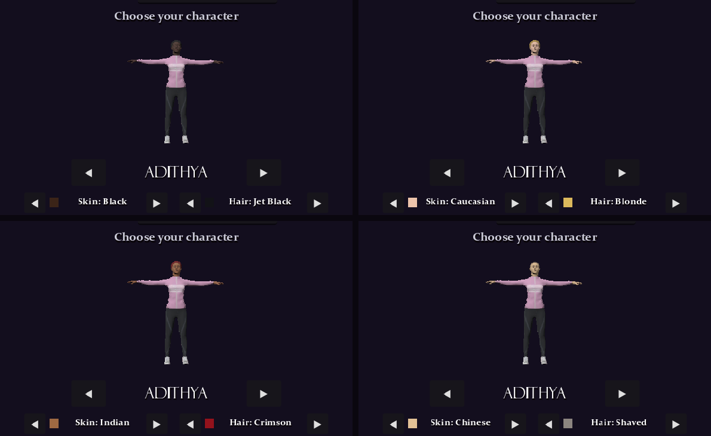</a>
      <br/><sub><strong>4 Skin Tone Presets &amp; 7 Hair Styles</strong> — Black, Caucasian, Indian &amp; Chinese skin tones + hair tinting via custom shader while outfits stay intact.</sub>
    </td>
  </tr>
  <tr>
    <td width="50%" align="center">
      <a href="docs/screenshots/07_body_part_hover.png">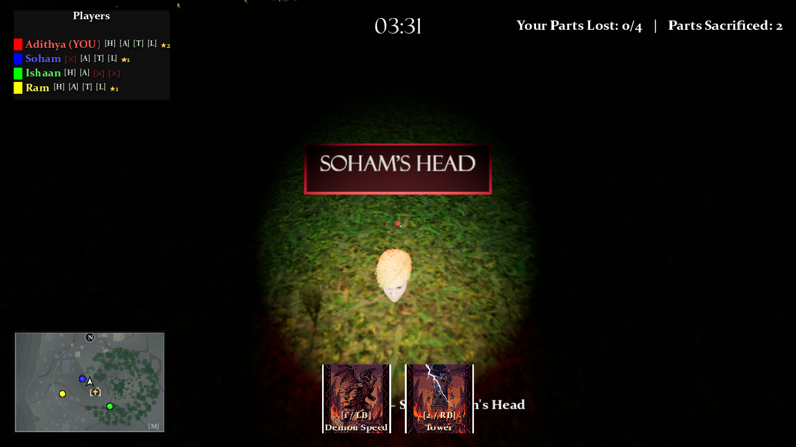</a>
      <br/><sub><strong>Physical <code>RigidBody3D</code> Body Parts</strong> — Severed limbs drop onto terrain with floating 3D owner tags, red beacon spotlights &amp; steal prompts.</sub>
    </td>
    <td width="50%" align="center">
      <a href="docs/screenshots/09_tarot_cards_tooltip.png">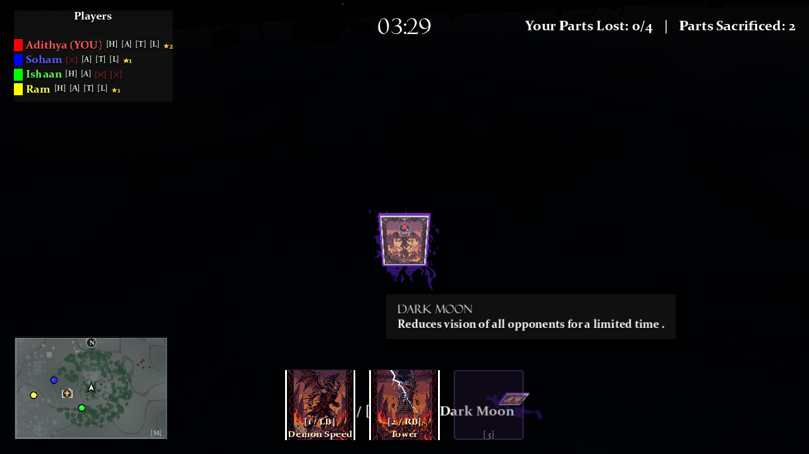</a>
      <br/><sub><strong>Tarot Deck &amp; Torso-Expanded Slots</strong> — Rim-shimmering pickups, hover tooltips, and dynamic 3rd/4th HUD slots unlocked via Torso sacrifices.</sub>
    </td>
  </tr>
  <tr>
    <td width="50%" align="center">
      <a href="docs/screenshots/10_blood_shrine_modal.png">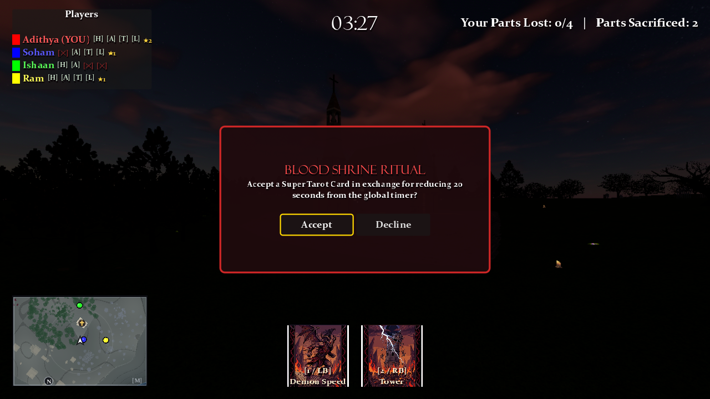</a>
      <br/><sub><strong>Blood Shrine Voting Ritual</strong> — Mid-match global vote: shave 20s off the match clock in exchange for the <code>Recaller</code> Super Card.</sub>
    </td>
    <td width="50%" align="center">
      <a href="docs/screenshots/11_ocean_panic_vignette.png">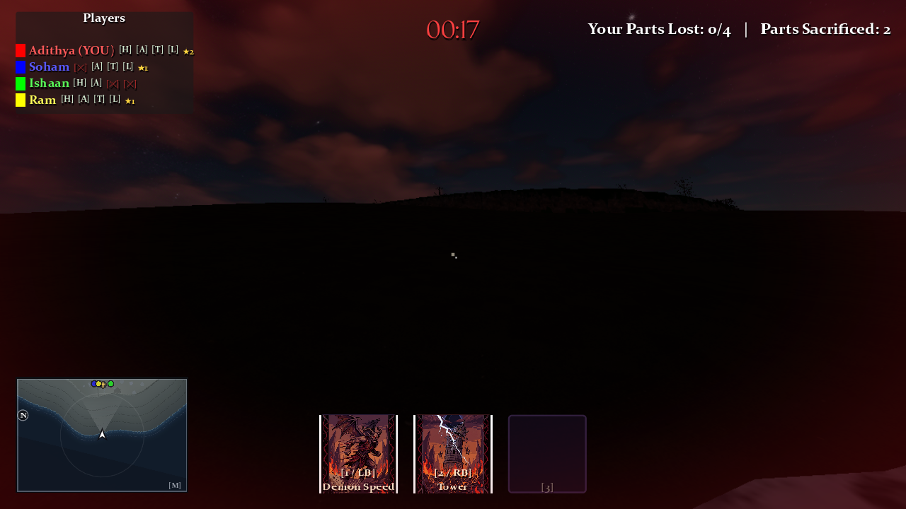</a>
      <br/><sub><strong>Ocean Buoyancy &amp; Under-60s Panic Vignette</strong> — Swimmable shoreline around the island + pulsing red vignette &amp; crimson countdown timer.</sub>
    </td>
  </tr>
</table>

---

## 🔍 Explore Every Feature (Click to Expand)

Click any panel below to inspect detailed screenshots, breakdowns, and examples for every system in `v2.0.0`.

<details open>
<summary><strong>🗺️ GTA V-Style Rotating Minimap Radar &amp; Multiplayer White Arrow Compass</strong></summary>
<br/>

<table>
  <tr>
    <td width="64%" align="center">
      <a href="docs/screenshots/06_gta_minimap_expanded.png"></a>
      <br/><sub><strong>In-Match HUD</strong>: Expanded <code>[M] WIDE</code> radar + crisp White Arrow Compass (with Soham's blue owner pip) centered at the bottom.</sub>
    </td>
    <td width="36%" align="center">
      <a href="Maps/Textures/minimap_island.png">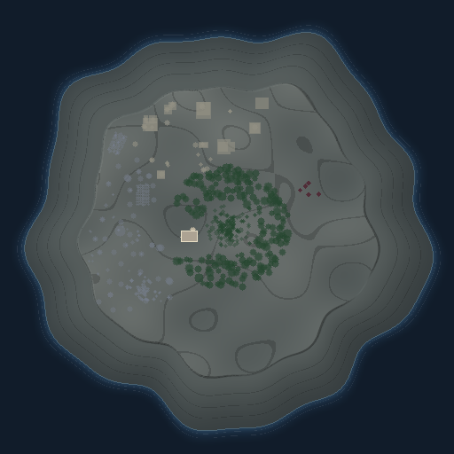</a>
      <br/><sub><strong>Baked Island Radar</strong> (<code>Maps/Textures/minimap_island.png</code>) generated directly from live <code>Terrain3D</code> height data, church footprints &amp; coastline.</sub>
    </td>
  </tr>
</table>

- **Zero-overhead baked terrain radar** (`tools/bake_minimap.gd` → `Maps/Textures/minimap_island.png`): No second 3D camera or extra render pass — a single 512×512 top-down map with coastline contours, ocean depth rings, forest canopy, and central church silhouette.
- **GTA V-style rotating frame** (`Maps/Scripts/MinimapUI.gd`): Rotates smoothly with your camera heading, displays a translucent white player FOV cone, a floating **`N`** north marker on the perimeter, a golden **Church Cross** icon at the altar, and **circular color-coded dots** for every opponent (clamped to the radar edge when far away).
- **Instant `[M]` zoom toggle**: Switch between compact radar (`184×132`) and expanded wide overview (`340×236`) on the fly without pausing.
- **Multiplayer-hardened White Arrow Compass (`CompassUI.gd`)**: Always points to the nearest opponent limb across both Host and ENet Clients (with a subtle owner-colored center pip), and automatically flips to **Crimson** pointing back to the **Church Altar** the moment you pick up a limb ([see screenshot](docs/screenshots/08_carrying_limb_altar_compass.png)).

</details>

<details>
<summary><strong>🎨 Player Customization (4 Skin Tones, 7 Hair Styles) &amp; Keyboard-Only Custom Names</strong></summary>
<br/>

<table>
  <tr>
    <td width="50%" align="center">
      <a href="docs/screenshots/03_lobby_customization.png"></a>
      <br/><sub><strong>3D Pre-Match Lobby</strong> — Live custom name input, Skin Tone &amp; Hair Color pickers, drag-to-orbit 3D preview &amp; LAN IP copy button.</sub>
    </td>
    <td width="50%" align="center">
      <a href="docs/screenshots/04_skin_hair_presets.png"></a>
      <br/><sub><strong>Live 3D Shader Showcase</strong> — <em>Black / Jet Black</em>, <em>Caucasian / Blonde</em>, <em>Indian / Crimson</em>, and <em>Chinese / Shaved</em> (clothes untouched).</sub>
    </td>
  </tr>
</table>

- **4 Preset Skin Tones**: `Default`, **`Black`**, **`Caucasian`**, **`Indian`**, and **`Chinese`**.
- **7 Hair Presets**: `Default`, **`Jet Black`**, **`Dark Brown`**, **`Blonde`**, **`Auburn`**, **`Silver`**, **`Crimson`**, and **`Shaved`** (blends scalp into your selected skin tone).
- **Luminance-preserving tint shader (`Materials/character_tint.gdshader`)**: Selectively classifies and re-tints skin vs. hair regions on each character's albedo texture while keeping eyes, eyebrows, and outfits completely untouched — synchronized across the 3D Lobby, in-match player avatars, and their severed `SplitParts` limbs!
- **Keyboard-only custom names**: Keyboard & mouse players can enter any custom display name (up to 16 chars, persisted in `Settings.gd` and synced via `NetworkManager.gd` to the HUD Legend, floating 3D `OwnerTag`s, Game Over leaderboard, and `.txt` exports). Gamepad players automatically keep clean default slot names (`Player 1`–`Player 4`) with the name input locked off to avoid on-screen keyboard friction.

</details>

<details>
<summary><strong>🦴 Physical Body Parts, Passive Limb Buffs &amp; Central Church Altar</strong></summary>
<br/>

<table>
  <tr>
    <td width="50%" align="center">
      <a href="docs/screenshots/07_body_part_hover.png"></a>
      <br/><sub><strong>Ground Pickup &amp; 3D OwnerTag</strong> — Severed limbs react to terrain physics, glow under a red beacon spotlight, and display the owner's custom name.</sub>
    </td>
    <td width="50%" align="center">
      <a href="docs/screenshots/08_carrying_limb_altar_compass.png"></a>
      <br/><sub><strong>Altar Run</strong> — Held limbs sway naturally in first-person while the compass turns crimson to guide you straight back to the Church Altar.</sub>
    </td>
  </tr>
</table>

| Sacrificed Limb | Permanent Passive Buff Granted |
| :--- | :--- |
| **Head** (`HeadPart`) | Widens camera Field of View for superior peripheral awareness |
| **Hands** (`HandsPart`) | Scales `push_force` knockback and interaction `reach_distance` |
| **Torso** (`TorsoPart`) | Boosts `slide_boost` momentum **and** unlocks extra Tarot Card HUD slots (`3` / `4`) |
| **Legs** (`LegsPart`) | Permanently increases walk and sprint speed |

</details>

<details>
<summary><strong>🃏 Tarot Cards &amp; The Blood Shrine Ritual</strong></summary>
<br/>

<table>
  <tr>
    <td width="50%" align="center">
      <a href="docs/screenshots/09_tarot_cards_tooltip.png"></a>
      <br/><sub><strong>Tarot Pickups &amp; Tooltips</strong> — Rim-shimmering cards in dark woods, rich hover descriptions, and dynamically expanding HUD slots.</sub>
    </td>
    <td width="50%" align="center">
      <a href="docs/screenshots/10_blood_shrine_modal.png"></a>
      <br/><sub><strong>The Blood Shrine Event</strong> — Mid-match ritual locks input for a global vote: accept to cut 20s off the timer and receive the <code>Recaller</code> card.</sub>
    </td>
  </tr>
</table>

| Tarot Card | Key / Trigger | Effect |
| :--- | :--- | :--- |
| **Dark Moon** | `1`–`4` / `LB` `RB` | Crushes target's camera far-plane &amp; fog density to near-blindness and narrows FOV for 5s |
| **Hanged Man** | `1`–`4` / `LB` `RB` | Flips `input_multiplier = -1.0` on victim client, completely inverting directional movement |
| **Demon Speed** | `1`–`4` / `LB` `RB` | Applies a `2.0×` raw movement speed multiplier for 10s |
| **The Tower** | `1`–`4` / `LB` `RB` | Unleashes radial impulse knockback, blasting nearby opponents backward |
| **Recaller** *(Super Card)* | Blood Shrine Vote | Teleports opponents back to their starting ritual stations |

</details>

<details>
<summary><strong>🌊 Swimmable Ocean Buoyancy, Under-60s Panic Vignette &amp; F3 Perf Overlay</strong></summary>
<br/>

<table>
  <tr>
    <td width="50%" align="center">
      <a href="docs/screenshots/11_ocean_panic_vignette.png"></a>
      <br/><sub><strong>Ocean &amp; Final-Minute Panic</strong> — Wading depth slowdown, shoulder-height wave buoyancy (<code>Y = 4.85</code>), pulsing red edge vignette &amp; red timer.</sub>
    </td>
    <td width="50%" align="center">
      <a href="docs/screenshots/05_church_altar_hud.png"></a>
      <br/><sub><strong>Live Telemetry (<code>F3</code>)</strong> — Toggle real-time FPS, frame time, and ENet RTT ping directly on top of gameplay during LAN tests.</sub>
    </td>
  </tr>
</table>

</details>

<details>
<summary><strong>⚙️ Main Menu, Extended Graphics/Audio Settings &amp; Pause Controls Card</strong></summary>
<br/>

<table>
  <tr>
    <td width="33.3%" align="center">
      <a href="docs/screenshots/01_main_menu.png">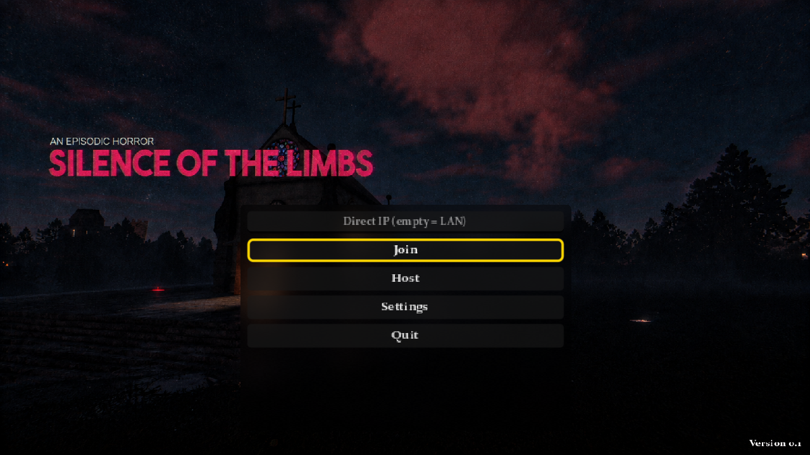</a>
      <br/><sub><strong>Main Menu</strong> — Persistent Direct IP input, LAN Auto-Discovery Join, Host, Settings &amp; Quit.</sub>
    </td>
    <td width="33.3%" align="center">
      <a href="docs/screenshots/02_settings_menu.png">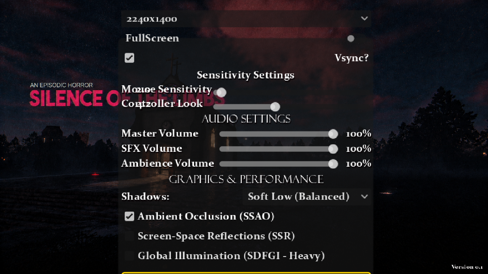</a>
      <br/><sub><strong>Extended Settings</strong> — Resolution, Fullscreen, VSync, Mouse/Gamepad Sensitivity, Master/SFX/Ambience %, Shadows, SSAO, SSR &amp; SDFGI.</sub>
    </td>
    <td width="33.3%" align="center">
      <a href="docs/screenshots/12_pause_menu_export.png">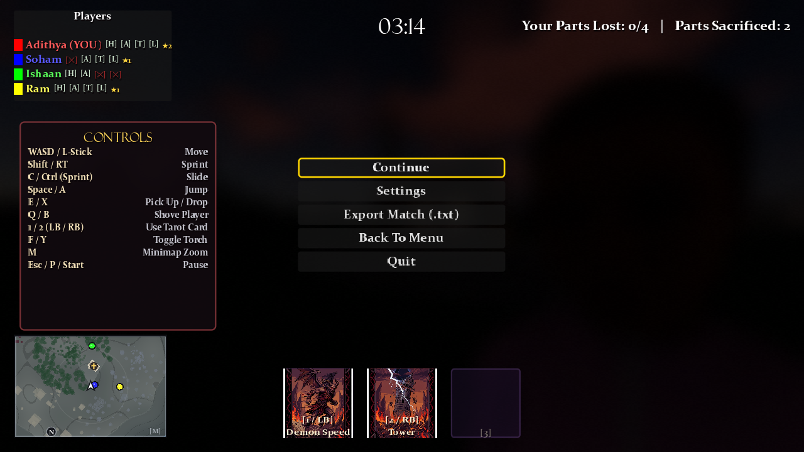</a>
      <br/><sub><strong>Pause Menu &amp; Controls Card</strong> — Compact keybind reference (including <code>M</code> Minimap Zoom) + one-click <code>Export Match (.txt)</code>.</sub>
    </td>
  </tr>
</table>

</details>

<details>
<summary><strong>📄 Plain-Text Match Export (<code>.txt</code>) with Native Save File Dialog</strong></summary>
<br/>

<table>
  <tr>
    <td width="50%" align="center">
      <a href="docs/screenshots/12_pause_menu_export.png"></a>
      <br/><sub><strong>Mid-Match Export</strong> — Click <strong>Export Match (.txt)</strong> anytime from the Pause Menu to open a native OS Save File Dialog.</sub>
    </td>
    <td width="50%" align="center">
      <a href="docs/screenshots/13_game_over_export.png">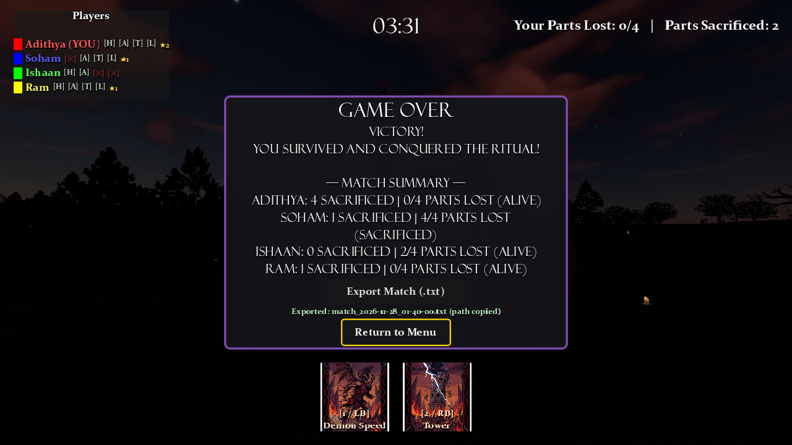</a>
      <br/><sub><strong>Post-Match Export</strong> — Save the complete final standings, limb states, customizations &amp; timestamped event log from the Game Over screen.</sub>
    </td>
  </tr>
</table>

<details>
<summary>📋 <em>Click to preview a real exported <code>match_*.txt</code> report generated by <code>MatchExporter.gd</code></em></summary>

```text
============================================================
SILENCE OF THE LIMBS — MATCH EXPORT (.TXT)
============================================================
Exported At:    2026-11-28 01:40:00
Match Started:  2026-11-28 01:36:14
Match State:    GAME_OVER
Time Elapsed:   03:46
Time Remaining: 01:14
Result:         Adithya

------------------------------------------------------------
PLAYERS
------------------------------------------------------------
  - Adithya (Red) | Status: ALIVE
      Avatar: Default | Skin: Indian | Hair: Crimson
      Sacrificed: 4 | Parts Lost: 0/4 [H][A][T][L]
  - Soham (Blue) | Status: SACRIFICED
      Avatar: Player 2 | Skin: Caucasian | Hair: Blonde
      Sacrificed: 1 | Parts Lost: 4/4 [X][X][X][X]
  - Ishaan (Green) | Status: ALIVE
      Avatar: Player 3 | Skin: Black | Hair: Jet Black
      Sacrificed: 0 | Parts Lost: 2/4 [H][A][X][X]
  - Ram (Yellow) | Status: ALIVE
      Avatar: Player 4 | Skin: Chinese | Hair: Shaved
      Sacrificed: 1 | Parts Lost: 0/4 [H][A][T][L]

------------------------------------------------------------
EVENT TIMELINE
------------------------------------------------------------
  [00:00] [MATCH_START] Match started with 4 players.
  [00:48] [SACRIFICE  ] Adithya sacrificed Soham's Head at the altar.
  [01:22] [BLOOD_SHRIN] Blood Shrine deal accepted (-20s timer, Recaller granted).
  [02:15] [SACRIFICE  ] Adithya sacrificed Soham's Torso at the altar.
  [03:46] [ELIMINATED ] Soham lost all 4 body parts and was sacrificed!
  [03:46] [GAME_OVER  ] Winner: Adithya
============================================================
```

</details>

</details>

---

## ⚙️ Core Systems & Implementation

### 1. Movement and Character Physics (`Player/Scripts/Player.gd`)
Default 3D character movement in Godot often feels like sliding on wet ice when making sudden turns. Because this is a high-speed game about chasing people carrying your limbs, the controller includes several custom physics tweaks:
- **Turn acceleration snapping**: Tracks `ground_turn_acceleration = 40.0` so opposing velocity vectors (`current_vel.dot(target_vel) < 0.0`) snap instantly instead of drifting.
- **Sliding**: Holding sprint + crouch triggers a directional slide boost (`1.35 * slide_boost * (0.6 + 0.4 * (slide_timer / 0.65))`) decaying over `0.65s` into crouch-walk.
- **Takeoff speed preservation**: Preserves horizontal sprint velocity into mid-air (`air_speed = max(current_speed, air_speed)`) with `air_control = 0.3`.
- **Input buffers & coyote time**: `0.15s` jump buffer and `0.10s` ledge coyote window.
- **Ocean buoyancy**: Smooth wading resistance plus shoulder-height deep-water floating (`WATER_FLOAT_CENTER_Y = 4.85`) with gentle wave bobbing.
- **Player shoving (`push_player`)**: Physical impulse knockback to deny altar deposits or pickups, gated by a `1.5s` client + server cooldown (`push_cooldown`).
- **First-person camera feel**: Speed-scaled sinusoidal headbob, smooth crouch/slide eye drop & roll tilt, landing dip, quadratic decaying trauma shake, and subtle handheld flashlight lag.

### 2. Physical Body Parts (`BodyParts/bodypart.gd`)
- Real `RigidBody3D` nodes with collision shapes, mass, terrain gravity, floating 3D `OwnerTag`, and red beacon spotlights.
- Automatic `.glb` fallback resolution across all 8 characters' `SplitParts` meshes, inheriting each player's custom Skin Tone and Hair shader tint.
- Authoritative host sacrifice validation at `SpellCenter.gd`, passive stat buffs per limb type, elimination on 4th loss, and timeout tie-breaking by fewest parts lost.

### 3. Tarot Cards & The Blood Shrine (`Tarot/`, `scripts/managers/GameManager.gd`)
- Modular Godot `Resource` definitions (`TarotCard.gd` + `TarotEffect` scripts) with violet rim-shimmering pickups, 2 base slots (expandable via `TorsoPart` buffs), hover tooltips, and tweened toast warnings.
- Mid-match **Blood Shrine** locks input and broadcasts a synchronized global vote: majority acceptance cuts `20s` off the timer and grants all yes-voters the `Recaller` Super Card.

### 4. HUD, Minimap, Compass, Customization & Match Export (`Maps/Scripts/`, `Models/characters/`)
- **GTA V-style rotating minimap** (`Maps/Scripts/MinimapUI.gd`) backed by a pre-baked 512×512 terrain texture (`tools/bake_minimap.gd`), circular player dots, Church marker, and `[M]` compact/wide zoom toggle.
- **Multiplayer-hardened White Arrow Compass** (`Maps/Scripts/CompassUI.gd`) tracking nearest valid opponent limbs across host and clients, flipping to Crimson toward the Church Altar while hauling a part.
- **Player Customization** (`Models/characters/PlayerCustomization.gd`, `Materials/character_tint.gdshader`) with 4 preset skin tones (`Black`, `Caucasian`, `Indian`, `Chinese`), 7 hair presets, and keyboard-only custom display names.
- **Plain-Text Match Export** (`scripts/managers/MatchExporter.gd`) with a native OS Save File Dialog accessible from both the Pause Menu and Game Over screen.
- **Playtest QoL**: Unfocused window auto-muting (`AudioManager.gd`), `F3` live FPS/ENet RTT ping overlay, persistent Direct IP (`last_direct_ip`), and one-click Host LAN IP copy.

### 5. Networking & Replication (`Networking/NetworkManager.gd`)
- Built on Godot's `ENetMultiplayerPeer` (port `8910`) with an authoritative host owning timers, limb spawns, eliminations, and sacrifice validation.
- **LAN Auto-Discovery & Direct IP**: Lightweight UDP beacon (`FINDERS_KEEPERS_HOST` on port `8911` via `PacketPeerUDP`) plus saved Direct IP fallback.
- **20Hz Interpolated Remote Puppets**: Sliding state buffers evaluated at `current_time - 0.12s` for smooth remote movement without rubber-banding.
- **Deferred Background Scene Streaming**: `ResourceLoader.load_threaded_request` streams `Maps/GameMode.scn` while players customize characters in the Lobby.

### 6. Performance & Load-Time Optimization (`tools/optimize_gamemode_scene.gd`)

| Optimization Layer | Before | After | Impact |
| :--- | :---: | :---: | :--- |
| **Cold Startup Boot** *(lazy FBX loading & lean Main Menu)* | `~30s` | **`~1s`** | **~30× faster boot** |
| **Match Scene File** *(`GameMode.tscn` → ZSTD `GameMode.scn`)* | `254.5 MB` | **`~122 MB`** | **~10× faster scene load** |
| **Scene Node Count** *(merged foliage + stripped empty colliders)* | `~21,000+` | **`-14,031 nodes`** | Huge scene-tree & physics win |
| **Sky3D Cumulus Raymarching** *(`SkyMaterial.gdshader`)* | `80 taps/px` | **`24 taps/px`** | **~3.3× faster sky pass** |
| **BoujieOcean Frame-1 Mesh Gen** *(LODs + `far_edge = 1800m`)* | Baseline | **`-75–80%`** | Instant spawn stability |
| **Minimap Radar Pass** *(pre-baked 512×512 PNG vs. 2nd camera)* | 2nd Viewport | **`0 extra 3D passes`** | **Zero FPS regression** |

### 7. Automated Mesh Slicing Tool (`tools/split_character_parts.py`)
A headless Blender Python script that slices Mixamo character FBXs into `head`, `hands`, `torso`, and `legs` `.glb` files automatically:
```bash
blender --background --python tools/split_character_parts.py
```

---

## 🎮 Controls

| Action | Keyboard &amp; Mouse | Controller (Gamepad) |
| :--- | :--- | :--- |
| **Move** | `W` `A` `S` `D` | Left Stick |
| **Look / Spin Lobby 3D Preview** | Mouse / Click-Drag | Right Stick |
| **Sprint** | `Shift` | Left Stick Click / Bumper |
| **Slide** *(while sprinting)* | `C` / `Ctrl` | Right Trigger / `B` |
| **Jump** | `Space` | `A` Button |
| **Interact / Pick Up / Drop** | `E` | `X` Button |
| **Shove / Push Player** *(1.5s CD)* | `Q` | `B` Button |
| **Use Tarot Card (Slot 1–4)** | `1` `2` (`3` `4` w/ Torso buff) | `LB` / `RB` or D-Pad Left / Right |
| **Toggle Minimap Zoom** | `M` | — |
| **Toggle Flashlight** | `F` | `Y` Button |
| **Toggle FPS &amp; Ping Overlay** | `F3` | — |
| **Pause / Controls / Export Match** | `Esc` / `P` | `Start` |
| **Lobby Character Cycle &amp; Custom Name** | `A`/`D` or `Q`/`E` • Name Input Box | D-Pad / Bumpers *(default slot name)* |

---

## 📦 Download `v2.0.0`

Pre-built standalone binaries for **Windows**, **macOS (Universal)**, and **Linux** are published on the [**`v2.0.0` GitHub Release**](https://github.com/vvadithya/FindersKeepers-CSES/releases/tag/v2.0.0):

| Platform | Package | Notes |
| :--- | :--- | :--- |
| **Windows (64-bit)** | `SilenceOfTheLimbs-v2.0.0-Windows-x64.zip` | Unzip and launch `SilenceOfTheLimbs.exe` (Vulkan Forward+) |
| **macOS (Universal)** | `SilenceOfTheLimbs-v2.0.0-macOS-Universal.zip` | Apple Silicon &amp; Intel `.app` bundle |
| **Linux (64-bit)** | `SilenceOfTheLimbs-v2.0.0-Linux-x86_64.tar.gz` | Extract, `chmod +x SilenceOfTheLimbs.x86_64`, and run |

> Verify integrity against `SHA256SUMS.txt` attached to the release.

---

## 📂 Project Structure

```text
FindersKeepers-CSES/
├── Audio/                  # AudioManager (lazy SFX, focus-mute), PlayerAudioController, ambient loops
├── BodyParts/              # Collectible RigidBody3D limbs (.glb fallback), passive buffs & SpellCenter altar
├── docs/screenshots/       # Live Vulkan gameplay & feature screenshots (.gdignore excluded from game PCK)
├── MainMenu/               # Horror Main Menu, 3D Lobby (custom names, skin/hair UI, LAN IP copy), Settings
├── Maps/                   # GameMode.scn (ZSTD binary), Terrain3D, extracted textures & minimap_island.png
│   ├── Scripts/            # MatchHUD, MinimapUI, CompassUI, PauseMenu, TarotInventoryUI, RenderScaler
│   └── Textures/           # Pre-baked 512×512 GTA V-style island radar (minimap_island.png)
├── Materials/              # Custom shaders including luminance-preserving character_tint.gdshader
├── Models/characters/      # Lazy CharacterCatalog, PlayerCustomization presets, Mixamo FBXs & SplitParts GLBs
├── Networking/             # NetworkManager (ENet peers, UDP LAN beacon, Direct IP, synced names & tints)
├── Player/                 # First-person Player.gd controller, Settings autoload, cached animation controller
├── scripts/managers/       # GameManager (state machine, Blood Shrine, event log) & MatchExporter (.txt + dialog)
├── Tarot/                  # TarotCard resources, effect scripts, fade-animated tooltips & toasts
└── tools/                  # Headless Blender limb slicer, binary scene optimizer & minimap radar baker
```

---

## 🛠️ Running from Source

### Requirements
- **Godot 4.7+ (Forward+ Vulkan renderer)**
- **Git LFS** (required to pull `Maps/GameMode.scn`, 3D models, and terrain textures)

### Setup
```bash
git clone https://github.com/vvadithya/FindersKeepers-CSES.git
cd FindersKeepers-CSES
git lfs pull
```
Open Godot 4.7+, import `project.godot`, and allow initial asset import to finish.

### Testing Multiplayer on One Machine
1. In the Godot editor, open **Debug > Run Multiple Instances** and pick **2** or **4** instances.
2. Press **F5** (unfocused windows auto-mute so ambient loops never stack).
3. On Instance 1, click **Host** (copy your LAN IP in the Lobby if testing across devices).
4. On Instance 2+, click **Join** for automatic UDP LAN discovery (or enter a Direct IP).
5. Enter custom names, pick your Skin Tone &amp; Hair Style, and click **Start Game**.

---

## 👥 Contributors

Built for CSES / Technozion by:
- **Vedula Venkata Adithya** ([@vvadithya](https://github.com/vvadithya) • [repository](https://github.com/vvadithya/FindersKeepers-CSES))
- **Ishaan Pandey** ([@TheSophisticated](https://github.com/TheSophisticated) • [upstream repository](https://github.com/TheSophisticated/FindersKeepers-CSES))
- **Soham Siddhartha Roy** ([@CleverFox29](https://github.com/CleverFox29) • [repository](https://github.com/CleverFox29/FindersKeepers-CSES))
- **Ram Siddhartha Mamillapalli** ([@RamSiddhartha](https://github.com/RamSiddhartha))
- **Tanmay Saraf** ([@tanmaysaraf07](https://github.com/tanmaysaraf07) • [repository](https://github.com/Tanmay-Saraf/FindersKeepers-CSES))
- **Kamran Bilal Bhat** ([@kamranbb-29](https://github.com/kamranbb-29))
- **Samyak Jain** ([@SamyakJain092006](https://github.com/SamyakJain092006) • [repository](https://github.com/SamyakJain092006/FindersKeepers-CSES))
